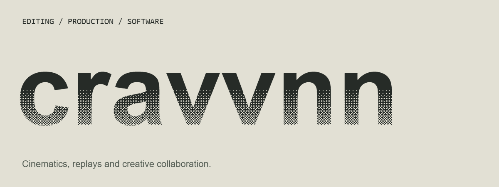

  

I'm Cravvnn, an editor and producer building software for cinematic and collaborative workflows.

[YouTube](https://www.youtube.com/@Cravvnn) · [X](https://x.com/Cravvnn) · [Community](https://discord.gg/deadlockediting)

## Creative Control for Deadlock replays

### [Deadlock Dolly ↗](https://github.com/cravvnn/deadlock-dolly)

Direct the camera inside local Deadlock replays. Shape movement, framing and capture.

### [RenderLock ↗](https://github.com/cravvnn/RenderLock)

Take replay performances into Blender for editable scenes, cinematics and stills.

## More ways to create

[**Vynk**](https://github.com/cravvnn/Vynk) — real-time collaboration in After Effects. 
[**CitadelCast**](https://github.com/cravvnn/deadlock-citadelcast) — camera and broadcast controls for live Deadlock matches.
