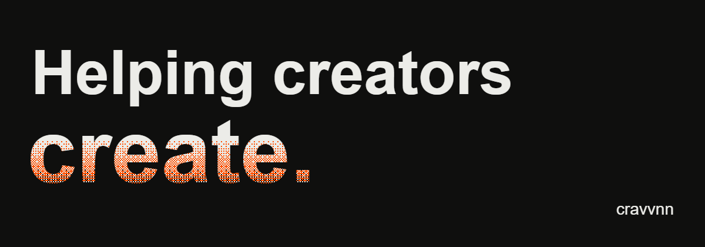

  

### I'm Cravvnn.

Editor, producer & developer. 
I make edits and build tools for cinematics.

**[View my work at cravvnn.link](https://cravvnn.link/)**

 

## Creative Control for Deadlock replays

### [Deadlock Dolly](https://github.com/cravvnn/deadlock-dolly)

Direct the camera inside local Deadlock replays. Shape camera paths, follow players, animate framing and capture footage for your edit.

### [RenderLock](https://github.com/cravvnn/RenderLock)

Bring Deadlock replay performances into editable Blender scenes, with recorded character animation, cameras and supported effects for cinematics and stills.

[See what creators are making with the tools](https://cravvnn.link/#credits).

## More ways to create

[**Vynk**](https://github.com/cravvnn/Vynk) — real-time collaboration in After Effects. Sync layers, keyframes and effects with live cursors while media stays on your machine.

**CitadelCast** — camera controls and broadcast tools for live Deadlock matches. Currently in development.

## Elsewhere on GitHub

Other projects I've contributed to: [modlock](https://github.com/paralin/modlock), [deadem](https://github.com/Igor-Losev/deadem), [s2replay](https://github.com/paralin/s2replay) and [go-deadlock](https://github.com/paralin/go-deadlock).

[Deadlock Editing community](https://discord.gg/deadlockediting)
